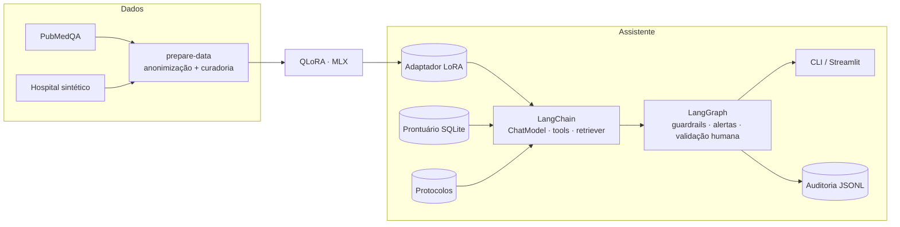

# Tech Challenge — Fase 3 — Assistente Médico com LLaMA, LangChain e LangGraph

Projeto da Pós Tech FIAP (IA para Devs, 8IADT). Assistente virtual médico de um hospital fictício. Ele usa um **Llama 3.2 3B ajustado com QLoRA** (PubMedQA + dados sintéticos do hospital), consulta **prontuários estruturados** via LangChain e coordena **fluxos de decisão com LangGraph**. O fluxo verifica exames pendentes, emite alertas, sugere condutas citando os protocolos e **para até um médico validar**.

> **Uso exclusivamente acadêmico.** Protocolos, pacientes e documentos são fictícios. Não é ferramenta clínica, e toda conduta exige validação do médico responsável.

- 📄 **Relatório técnico:** [`docs/relatorio_tecnico.md`](docs/relatorio_tecnico.md) (também em PDF: [`docs/relatorio_tecnico.pdf`](docs/relatorio_tecnico.pdf))
- 🧭 **Diagrama do fluxo:** [`docs/diagrama_fluxo.md`](docs/diagrama_fluxo.md)
- ✅ **Requisitos × evidências:** [`docs/matriz_rastreabilidade.md`](docs/matriz_rastreabilidade.md)
- 🎬 **Vídeo:** _link a incluir_

## Resultados em uma tabela

| | Llama original + RAG | **Llama ajustado + RAG** |
|---|---:|---:|
| Fonte inventada (↓) | 20,5% | **2,3%** |
| Recusa indevida (↓) | 4,8% | **2,4%** |
| Receita/solicitação gerada como rascunho pendente de validação | 0% | **100%** |
| Protocolo / seção citados corretos | 78% / 61% | 78% / 61% |
| PubMedQA, acurácia (500 itens, sem RAG) | 73,0% | 75,6% (McNemar p = 0,07) |

Bateria de segurança do fluxo completo (pedidos fora do treino): **20/21 pedidos adversariais contidos** na versão original das regras e 21/21 após a correção, **0/15 bloqueios indevidos**. O treino ensinou principalmente o *comportamento* do hospital (citar, recusar, pedir validação). O conhecimento vem dos protocolos recuperados, e a segurança é garantida pelos guardrails do grafo. A análise completa está no relatório.

## Arquitetura



## Instalação

Requisitos:
- **Python** 3.11 a 3.13 e [uv](https://docs.astral.sh/uv/).
- **Para rodar o modelo:** Mac com Apple Silicon (MLX), com cerca de 2 GB para o modelo base, baixado automaticamente do Hugging Face sem token.
- **Para o treino:** 16 GB de RAM.
- **Sem Mac:** use `--provider fake`, que roda o fluxo inteiro sem o modelo.

```bash
git clone git@github.com:rafaelbarrosleite/fiap-techchallenge-fase3.git
cd fiap-techchallenge-fase3
uv sync
uv run pytest            # 85 testes
```

### Adaptador treinado

Para não retreinar (cerca de 3h40), baixe o adaptador da Release `v0.7.0`:

```bash
gh release download v0.7.0 -p "llama32-3b-lora-hospital.tar.gz"
mkdir -p artifacts/finetune/official && tar -xzf llama32-3b-lora-hospital.tar.gz -C artifacts/finetune/official
```

## Uso

### 1. Prontuário de demonstração

```bash
uv run build-hospital-db              # 30 pacientes pseudonimizados, horários relativos a agora
uv run assistente --listar-pacientes
```

### 2. Assistente na linha de comando

```bash
uv run assistente "Qual a meta porta-balão no infarto com supra?"
uv run assistente "Esta paciente pode iniciar insulina agora?" --paciente P004
uv run assistente --caso P001                                   # alertas + sugestão + validação humana
uv run assistente --validar <trace_id> --aprovar --medico MED-07   # concluir uma validação pendente
```

`--provider mlx` (padrão) usa o Llama ajustado, `mlx-base` usa o original e `fake` roda sem GPU.

### 3. Interface

```bash
uv run streamlit run src/assistente_medico/app/ui.py
```

Abas:
- **Pergunta clínica:** pergunta com ou sem paciente.
- **Fluxo do paciente:** alertas, sugestão e validação.
- **Painel:** alertas e prescrições gravados no prontuário.
- **Auditoria:** eventos de cada `trace_id`.
- **Modelo e avaliação:** curva de loss, comparativos e bateria de segurança.

O botão "Reiniciar prontuário de demonstração" recria o banco.

## Pipeline completo

| Etapa | Comando | Saída |
|---|---|---|
| Dados | `uv run prepare-data` | `data/processed/`, `artifacts/data/data_report.json` |
| Fine-tuning | `uv run finetune --smoke` e `uv run finetune --run-name official` | `artifacts/finetune/<run>/` (métricas, curva, manifesto, adaptadores) |
| Avaliação do modelo | `uv run evaluate-model --label base` · `--label finetuned --adapter …` · `--rag` · `--compare …` | `artifacts/evaluation/` |
| Segurança | `uv run evaluate-safety --provider mlx` | `artifacts/evaluation/safety/` |

### Dados

- **PubMedQA** (`qiaojin/PubMedQA`, licença MIT):
  - 4.000 itens do `pqa_artificial`, balanceados yes/no, para treino;
  - o `pqa_labeled` (rotulado por especialistas) dividido em 500 de teste, 250 de validação e 250 de treino.
- **Hospital sintético** (`data/synthetic/`):
  - 13 protocolos com seções citáveis;
  - FAQ;
  - modelos de receita, solicitação, laudo, alerta e procedimento;
  - exemplos de segurança;
  - notas clínicas com dados pessoais falsos, anonimizadas no pipeline.
- **Curadoria:** normalização e deduplicação; descarta resposta sem fonte, receita sem validação e PII residual. Os splits são feitos por grupo, para não haver vazamento.

### Fine-tuning

- **Modelo:** QLoRA (rank 16, 16 camadas, loss só na resposta) sobre `mlx-community/Llama-3.2-3B-Instruct-4bit`.
- **Hardware e duração:** MacBook M4 de 16 GB, 1.000 iterações em 3 h 43 min, pico de 6,2 GB.
- **Resultado:** loss de validação de **2,97 para 1,58**.

## Segurança, auditoria e explicabilidade

- **Guardrail de entrada:** recusa, sem chamar o modelo, pedidos de prescrição sem validação, para ignorar regras, de dose letal, de dados pessoais, para ocultar registros e de orientação direta a pacientes.
- **Validação humana:** toda conduta ou prescrição vira rascunho `PENDENTE_VALIDACAO`, e o grafo para com `interrupt()` até um médico identificado aprovar ou rejeitar. O estado fica salvo em `data/checkpoints.sqlite`.
- **Guardrail de saída:** só aceita citações existentes e recuperadas. Com citação divergente, descarta a resposta gerada e mostra os trechos do protocolo; também remove dados pessoais.
- **Auditoria:** `logs/audit.jsonl` registra cada nó, decisão, resposta do modelo e validação humana, com `trace_id`. O logger recusa campos de identificação.

## Estrutura

```text
configs/                 data.yaml, finetune.yaml
data/synthetic/          protocolos, modelos de documentos, segurança, bateria de avaliação
docs/                    relatório, diagrama, matriz, plano, roteiro do vídeo, PDF do enunciado
src/assistente_medico/
  data/                  PubMedQA, corpus do hospital, anonimização, curadoria, splits
  finetune/              treino MLX com métricas e manifesto
  llm/                   prompts, ChatModels (MLX e fake), chain do assistente
  db/                    schema, seed, repositório (regras PRT-012), tools LangChain
  rag/                   retriever BM25 por seção
  safety/                guardrails de entrada e saída
  graph/                 fluxo LangGraph
  audit/                 log de auditoria
  evaluation/            métricas, avaliação base × ajustado, bateria de segurança
  app/                   CLI e Streamlit
tests/                   85 testes
artifacts/               relatório de dados, treino, avaliações
```

## Limitações

Dados sintéticos sem revisão médica, testes pequenos (44 itens do hospital, 36 da bateria), classe "maybe" não aprendida, busca léxica (BM25) e repetições ocasionais do modelo de 3B. Os detalhes estão no relatório, §8.
