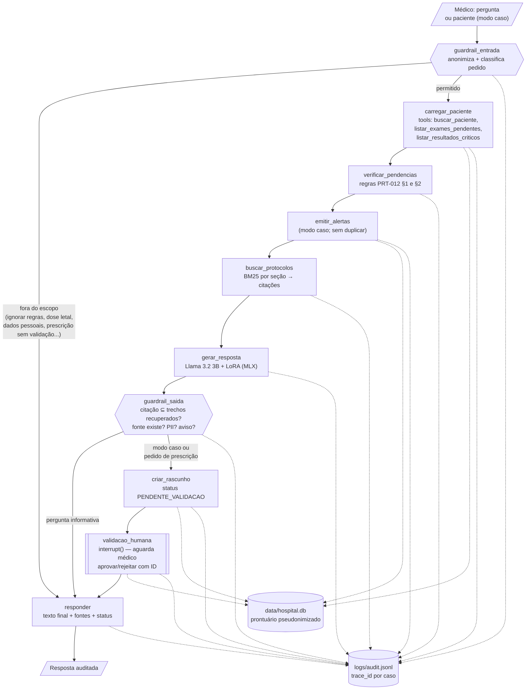
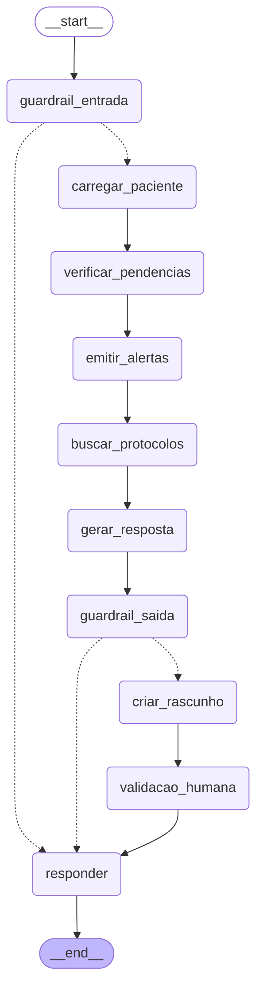

# Diagrama do fluxo LangChain + LangGraph

O LangChain fornece as peças (modelo de chat, retriever, ferramentas de prontuário). O LangGraph define a ordem, as decisões e a pausa para validação humana. Código: [`graph/workflow.py`](../src/assistente_medico/graph/workflow.py).

## Visão funcional

## Grafo compilado (gerado pelo LangGraph)

Gerado com `build_graph().get_graph().draw_mermaid()`. Arestas tracejadas são condicionais.

## Decisões

| Ponto | Decisão | Motivo |
|---|---|---|
| Escolha de ferramentas | Orquestração fixa no grafo, não pela LLM | O modelo de 3B não é confiável para decidir sozinho quais ferramentas chamar; o fluxo determinístico é auditável |
| Validação humana | `interrupt()` + checkpointer | O grafo para, persiste o estado e só continua com a decisão de um médico identificado |
| Citações | Guardrail compara a citação do modelo com os trechos recuperados | A avaliação (M3) mostrou que o modelo ajustado erra a seção citada; a lista de fontes exibida vem sempre do sistema |
| Alertas | Gerados por regra (PRT-012), não pela LLM | Pendências e valores críticos são fatos do prontuário; não dependem de geração de texto |
| Auditoria | `node_start`/`node_end` de cada nó + eventos de decisão, com `trace_id` | Reconstrói o caminho completo de cada caso. Ao retomar após o `interrupt`, o nó de validação é reexecutado, por isso aparece com dois `node_start` |
