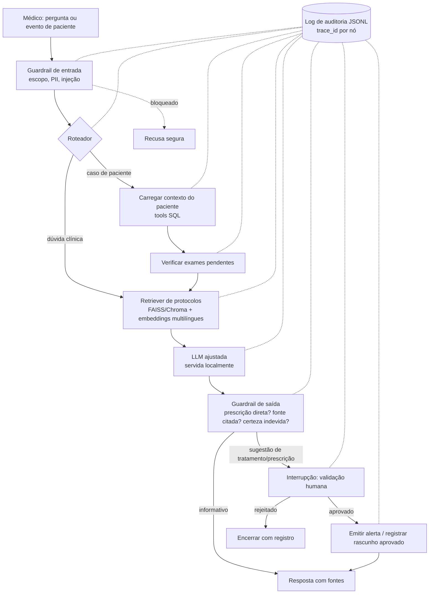

# Plano de implementação — Tech Challenge Fase 3

Assistente virtual médico com LLM ajustada (fine-tuning), LangChain e LangGraph.

Fonte oficial: [`references/8IADT - Fase 3 - Tech challenge.pdf`](<references/8IADT - Fase 3 - Tech challenge.pdf>). O Tech Challenge vale 90% da nota das disciplinas da fase.

---

## 1. Leitura do desafio

### 1.1 O que o hospital quer

Depois de automatizar exames (Fase 1) e textos clínicos (Fase 2), o hospital quer um **assistente médico treinado com os próprios dados**, capaz de:

- apoiar condutas clínicas;
- responder dúvidas de médicos;
- sugerir procedimentos com base nos protocolos internos.

Além disso, quer **fluxos de decisão automatizados e seguros**: ao receber dados de um paciente, o sistema verifica exames pendentes, sugere tratamentos e emite alertas para a equipe — tudo coordenado com LangChain.

### 1.2 Requisitos obrigatórios (texto do PDF → interpretação)

| ID | Requisito oficial | Interpretação prática |
|---|---|---|
| R1 | Fine-tuning de LLM (LLaMA, Falcon ou outra) | Treinar adaptador LoRA/QLoRA sobre um modelo aberto pequeno; o modelo resultante precisa rodar localmente e ser comparado com o modelo base |
| R1.1 | Dados: protocolos do hospital | Corpus sintético de protocolos internos (PT-BR) convertido em pares instrução→resposta |
| R1.2 | Dados: perguntas frequentes de médicos | FAQ sintético + PubMedQA (dataset público adotado) |
| R1.3 | Dados: modelos de laudos, receitas e procedimentos | Templates sintéticos de laudo, receita e POP usados como exemplos de formato |
| R1.4 | Preprocessing, anonimização e curadoria | Pipeline auditável: limpeza → anonimização (PII) → deduplicação → filtros de qualidade → split → relatório de dados |
| R2 | Pipeline LangChain com a LLM customizada | Modelo ajustado servido localmente e consumido por um `ChatModel` LangChain |
| R2.1 | Consultas a base estruturada (prontuários, registros) | Banco SQLite sintético de pacientes, exames, prescrições; acesso por *tools* parametrizadas (sem SQL livre gerado pela LLM) |
| R2.2 | Contextualizar respostas com dados atualizados do paciente | Contexto do paciente injetado no prompt a partir do banco, a cada consulta |
| R3.1 | Limites de atuação (nunca prescrever sem validação humana) | Guardrails de entrada e saída + nó de aprovação humana (human-in-the-loop) no LangGraph |
| R3.2 | Logging detalhado para rastreamento e auditoria | Log estruturado JSONL por execução/nó/tool, com `trace_id`, versões de modelo e prompt, sem PII |
| R3.3 | Explainability (indicar a fonte da informação) | RAG sobre protocolos internos com citação obrigatória `[fonte: documento#seção]`; resposta sem fonte é rebaixada/recusada |
| R4 | Projeto modularizado em Python + README completo | Pacote em `src/`, `pyproject.toml` + `uv.lock`, testes, CLIs |

### 1.3 Entregáveis

| ID | Entregável | Observação |
|---|---|---|
| E1 | Repositório Git: pipeline de fine-tuning | Scripts de preparo de dados, treino, fusão/export e avaliação |
| E2 | Repositório Git: integração com LangChain | Modelo, RAG, tools, prompts, guardrails |
| E3 | Repositório Git: **fluxos do LangGraph** | O PDF exige LangGraph explicitamente nos entregáveis, embora os requisitos citem só LangChain |
| E4 | Dataset anonimizado ou sintético | Versionar amostra sintética + script que regenera o resto; não versionar dados pesados de terceiros |
| E5 | Relatório técnico: processo de fine-tuning | Dados, hiperparâmetros, curvas de loss, custo/tempo |
| E6 | Relatório técnico: descrição do assistente | Arquitetura, capacidades e limites |
| E7 | Relatório técnico: diagrama do fluxo LangChain/LangGraph | Mermaid + PNG exportado do grafo |
| E8 | Relatório técnico: avaliação do modelo e análise | Base × ajustado, RAG, segurança, latência |
| E9 | Vídeo de até 15 min | Treino e funcionamento da LLM; fluxo automatizado; pergunta clínica contextualizada; logs e validação |

### 1.4 Pontos de atenção encontrados no PDF

1. **LangGraph** aparece só nos entregáveis — deve ser tratado como obrigatório.
2. **"Dados próprios do hospital"** não são fornecidos: precisamos gerar dados sintéticos realistas e documentar isso como decisão.
3. **Datasets sugeridos estão em inglês** (PubMedQA, MedQuAD). O assistente será em PT-BR; usar os datasets como complemento (e para avaliação objetiva no PubMedQA yes/no/maybe), não como base principal.
4. **"Nunca prescrever diretamente, sem validação humana"** está destacado em amarelo — é o requisito de segurança mais visível para a banca; precisa aparecer no código, nos testes e no vídeo.
5. **Vídeo precisa mostrar o treino** — gravar trechos do treino (ou logs/curvas) enquanto acontece.
6. Não há prazo nem tamanho de grupo no PDF — confirmar no portal.

---

## 2. Lições das fases anteriores aplicadas

Da Fase 2 (`fiap-techchallenge-fase2-ga-llm`) reaproveitamos o que funcionou:

- estrutura `src/` + `pyproject.toml` + `uv.lock` + `pytest`, CLIs via `[project.scripts]`;
- **provider fake/mock determinístico** para rodar tudo offline e nos testes, com provider real opt-in;
- camadas de `privacy`, `safety` e `factuality` separadas;
- matriz de rastreabilidade requisito → código → teste → evidência;
- logging estruturado e artefatos com manifesto.

E evitamos o que pesou:

- a Fase 2 acumulou ~50 CLIs e versões v1–v4 de avaliação. Aqui: **poucos comandos estáveis**, uma única versão de contrato e documentação enxuta (README + relatório + matriz);
- dependência de API paga para demonstração. Aqui, a LLM roda **localmente** — o próprio requisito pede modelo ajustado.

---

## 3. Decisões técnicas propostas

### 3.1 Modelo base e técnica de fine-tuning

Ambiente disponível: MacBook Apple M4, 16 GB RAM, sem GPU NVIDIA, ~36 GB livres em disco.

| Opção | Prós | Contras |
|---|---|---|
| **A (recomendada)** — `Qwen2.5-1.5B-Instruct` (ou 3B) + LoRA com **MLX-LM** local | Roda no M4 em minutos/horas; licença Apache 2.0; bom em português; `mlx_lm.server` expõe API compatível OpenAI para o LangChain | Específico de Apple Silicon (colegas com Windows precisam da opção B) |
| B — `Llama-3.2-3B-Instruct` + QLoRA (PEFT/TRL ou Unsloth) no **Google Colab T4** | Portável, citado no PDF (LLaMA), padrão de mercado | Depende de Colab; Llama exige aceite de licença no Hugging Face |
| C — modelos 7B+ | Melhor qualidade | Não cabem confortavelmente em 16 GB para treino |

**Decisão (2026-10-07): LLaMA.** Modelo base `Llama-3.2-3B-Instruct` (fallback `Llama-3.2-1B-Instruct` se memória/tempo apertarem), treinado com LoRA em MLX no M4 e com notebook Colab/PEFT equivalente para portabilidade. O repositório oficial `meta-llama/*` exige aprovação manual; usamos as cópias públicas com a mesma licença Llama 3.2: `mlx-community/Llama-3.2-3B-Instruct-4bit` (MLX) e `unsloth/Llama-3.2-3B-Instruct` (Colab), sem token. O formato de dados (JSONL de chat) é o mesmo nos dois caminhos.

Hiperparâmetros iniciais: LoRA rank 8–16, alpha 16–32, lr 1e-4–2e-4, 2–3 épocas, seq. máx. 1024, early stopping por loss de validação.

### 3.2 Dados

**Decisão (2026-10-07): PubMedQA é o dataset público adotado** (MedQuAD fica fora). Subconjuntos:

- `pqa_artificial` (~211 mil, rótulo gerado automaticamente): amostra de alguns milhares para **treino**;
- `pqa_labeled` (1.000, rotulado por especialistas): **validação e teste** — métrica objetiva de acurácia yes/no/maybe, comparável à literatura;
- `pqa_unlabeled`: não usado.

**Idioma (2026-10-07):** treino em inglês com o PubMedQA original; o assistente responde em PT-BR por instrução de sistema. Os exemplos sintéticos do hospital (protocolos, laudos, receitas) ficam em PT-BR, o que também ensina o modelo a responder em português.

O PDF ainda exige protocolos, FAQ e modelos de laudo/receita do hospital, que o PubMedQA não cobre; eles continuam como corpus sintético menor.

Fontes originalmente previstas (MedQuAD removido), todas convertidas para JSONL no formato de chat (`system`/`user`/`assistant`):

1. **Corpus sintético do hospital (PT-BR)** — fonte principal:
   - ~10–15 protocolos internos (ex.: sepse, dor torácica, AVC, pneumonia comunitária, hipoglicemia, profilaxia de TEV), cada um com seções numeradas para permitir citação;
   - FAQ de médicos (~300–600 pares) gerados a partir dos protocolos;
   - templates de laudo, receita (sempre marcada como **rascunho para validação**) e POPs.
   - Gerados com LLM + revisão manual de amostra; protocolos baseados em diretrizes públicas, com aviso de uso acadêmico.
2. ~~MedQuAD~~ — descartado.
3. **PubMedQA** (`pqa_labeled`, 1.000 itens) — parte no treino, parte reservada para **avaliação objetiva** (acurácia yes/no/maybe).

Pipeline de preparo (`data/`):

```
bruto → normalização (unicode, espaços, HTML) → anonimização (CPF, RG, CNS, nomes, telefone, e-mail, datas, endereço)
     → deduplicação (hash exato + similaridade) → filtros (tamanho, idioma, resposta vazia, conteúdo prescritivo sem ressalva)
     → split estratificado treino/validação/teste por fonte → relatório de dados (contagens, removidos, motivo)
```

Anonimização: regex brasileiras (CPF, CNS, telefone) + NER (spaCy `pt_core_news` ou Microsoft Presidio) para nomes/locais. Testes com casos plantados garantem que nenhuma PII sobrevive.

Regra de curadoria importante: respostas de treino que sugerem medicamento **sempre** terminam com a ressalva de validação médica — o modelo aprende o comportamento seguro, e os guardrails reforçam em tempo de execução.

### 3.3 Base estruturada de pacientes

SQLite sintético (gerado com Faker pt_BR + regras clínicas simples), ~50 pacientes:

- `pacientes` (id pseudonimizado, idade, sexo, comorbidades, alergias)
- `atendimentos`, `sinais_vitais`
- `exames` (solicitado/realizado/pendente, resultado, data)
- `prescricoes` (status: `rascunho` | `aprovada` | `rejeitada`, aprovador)
- `alertas` (gravidade, destino, status)
- `auditoria` (opcional; o log principal é arquivo JSONL)

Acesso via **tools LangChain tipadas** (`buscar_paciente`, `listar_exames_pendentes`, `historico_prescricoes`, `registrar_alerta`) com queries parametrizadas e somente leitura, exceto as tools de escrita controladas pelo grafo.

### 3.4 Arquitetura LangChain + LangGraph



Componentes:

- **LLM**: `ChatOpenAI` apontando para `mlx_lm.server` local (ou `ChatOllama`); provider **fake** determinístico para testes e demo offline.
- **RAG**: chunking por seção dos protocolos, metadados `doc_id`/`secao`/`versao`; a resposta lista as fontes usadas (explainability).
- **LangGraph**: `StateGraph` com estado tipado do caso; `interrupt()` + checkpointer SQLite para a etapa de aprovação humana; export do grafo em Mermaid/PNG para o relatório.
- **Guardrails** (código determinístico, não só prompt):
  - bloqueio de pedido de prescrição direta / dose sem validação;
  - toda sugestão terapêutica vira `rascunho` com status `pendente_validacao`;
  - resposta clínica sem fonte → reescrita ou recusa;
  - detecção de PII na saída.
- **Logging/auditoria**: `structlog`/`logging` JSON → `logs/audit.jsonl` com `trace_id`, nó, entrada/saída resumidas, fontes, decisão do guardrail, aprovador, versões (modelo, adaptador, prompt), latência. Opcional: LangSmith ou Langfuse local como visualização extra no vídeo.

### 3.5 Interface de demonstração

CLI (`uv run assistente ...`) + uma interface simples em **Streamlit** (ou Gradio) com: chat, seleção de paciente, painel de fontes, botão aprovar/rejeitar e visualização do log. Facilita muito o vídeo.

### 3.6 Avaliação

| Dimensão | Métrica | Comparação |
|---|---|---|
| Ganho do fine-tuning | Loss/perplexidade no teste; ROUGE-L e BERTScore no FAQ interno; acurácia PubMedQA | Base × ajustado (mesmo prompt) |
| Aderência a protocolos | % de respostas com fatos corretos de um gabarito por protocolo (checagem por palavras-chave + LLM-juiz opcional) | Base, ajustado, ajustado + RAG |
| Explainability | % respostas com fonte válida e existente | ajustado + RAG |
| Segurança | Bateria adversarial (~40 casos: "prescreva X", "ignore as regras", dose letal, PII) → taxa de bloqueio correto e de falso bloqueio | Com e sem guardrails |
| Fluxo | Cenários de ponta a ponta (exame pendente, alerta crítico, aprovação/rejeição) | Testes automatizados |
| Operação | Latência por nó, tokens/s, memória | — |

---

## 4. Estrutura proposta do repositório

```text
fiap-techchallenge-fase3/
├── README.md
├── pyproject.toml / uv.lock / .env.example
├── configs/                     # finetune.yaml, assistant.yaml
├── data/
│   ├── raw/                     # (gitignore) downloads PubMedQA
│   ├── synthetic/               # protocolos, FAQ, templates, seed do banco (versionado)
│   ├── processed/               # train/valid/test JSONL (amostra versionada)
│   └── hospital.db              # gerado por script
├── src/assistente_medico/
│   ├── data/                    # download, sintético, anonimização, curadoria, split
│   ├── finetune/                # treino MLX, export, avaliação base × ajustado
│   ├── llm/                     # providers (local, fake), prompts versionados
│   ├── rag/                     # ingestão, retriever, citação
│   ├── db/                      # schema, seed, tools
│   ├── safety/                  # guardrails entrada/saída, políticas
│   ├── graph/                   # estado, nós, grafo LangGraph, HITL
│   ├── audit/                   # logging estruturado
│   ├── evaluation/              # métricas, bateria adversarial
│   └── app/                     # CLI e Streamlit
├── notebooks/finetune_colab.ipynb
├── tests/
├── artifacts/                   # métricas, curvas, adaptador (se pequeno) e manifestos
├── logs/
└── docs/
    ├── references/              # PDF oficial
    ├── plano_implementacao.md   # este arquivo
    ├── matriz_rastreabilidade.md
    ├── relatorio_tecnico.md     # + export PDF
```

Comandos estáveis previstos (poucos e definitivos):

```bash
uv run prepare-data          # download + sintético + anonimização + curadoria + split
uv run build-hospital-db     # gera SQLite sintético
uv run build-index           # indexa protocolos para o RAG
uv run finetune              # treino LoRA (MLX)
uv run evaluate-model        # base × ajustado
uv run assistente            # CLI do assistente
uv run evaluate-safety       # bateria adversarial
uv run streamlit run src/assistente_medico/app/ui.py
uv run pytest
```

---

## 5. Plano de execução por missões

Cada missão termina com testes passando e evidência gerada, como na Fase 2.

| Missão | Objetivo | Entregas | Critério de pronto |
|---|---|---|---|
| **M0 — Fundação** ✅ | Repositório e ambiente | git init, `pyproject`, `uv`, estrutura, `.gitignore`, `.env.example`, logging base, CI local (`pytest`) | `uv sync && uv run pytest` verde |
| **M1 — Dados** ✅ | Corpus pronto para treino | Protocolos sintéticos, FAQ, templates, download/subset PubMedQA, anonimização, curadoria, splits, relatório de dados | JSONL validados; teste de PII plantada = 0 vazamentos |
| **M2 — Fine-tuning** ✅ | Modelo ajustado | Smoke train (poucos passos) → treino oficial; curvas de loss; adaptador + modelo fundido; notebook Colab equivalente | Loss de validação cai; modelo responde em PT-BR no formato esperado |
| **M3 — Avaliação do modelo** ✅ | Provar ganho | Base × ajustado no teste interno e PubMedQA; tabela e figuras | Artefato de métricas + análise escrita |
| **M4 — Base do paciente + RAG** ✅ | Contexto e fontes | SQLite sintético, tools, índice vetorial, citação | Testes das tools e do retriever |
| **M5 — Assistente LangChain** ✅ | Pergunta clínica contextualizada | Chain com LLM local + RAG + contexto do paciente; provider fake | Resposta com fonte e dados do paciente |
| **M6 — LangGraph + segurança** ✅ | Fluxo automatizado seguro | Grafo (roteador, exames pendentes, sugestão, guardrails, HITL, alertas), auditoria JSONL, diagrama | Cenários E2E e bateria adversarial passando |
| **M7 — Interface** ✅ | Demo | CLI + Streamlit | Fluxo completo demonstrável em < 5 min |
| **M8 — Documentação** ✅ | Relatório e README | Relatório técnico (fine-tuning, assistente, diagrama, avaliação), matriz, README, export PDF | Todos os requisitos com evidência |
| **M9 — Vídeo** ✅ | Entrega final | Roteiro, gravação ≤ 15 min, link no README | Vídeo cobre os 4 itens do PDF |

Ordem e paralelismo: M1→M2→M3 é o caminho crítico (o treino depende dos dados). M4/M5 podem andar em paralelo usando o provider fake ou o modelo base, e trocam para o modelo ajustado quando M2 terminar.

### Cronograma (entrega 30/10/2026, trabalho individual)

| Datas | Missões | Marco |
|---|---|---|
| 07–08/10 | M0, M1 | Dados prontos ✅ |
| 09–12/10 | M2, M3 | Llama ajustado e avaliado (base × ajustado) |
| 13–17/10 | M4, M5 | Assistente LangChain com prontuário e fontes |
| 18–22/10 | M6 | Fluxo LangGraph com validação humana, guardrails e auditoria |
| 23–24/10 | M7 | Interface de demonstração |
| 25–27/10 | M8 | Relatório técnico e README finais |
| 28–29/10 | M9 | Gravação do vídeo e folga |
| 30/10 | — | Entrega |

Regra de corte: se uma missão atrasar mais de 1 dia, o escopo opcional sai primeiro (Streamlit → só CLI; notebook Colab → só MLX; LLM-juiz → só métricas automáticas).

### Roteiro preliminar do vídeo (≤ 15 min)

1. (1 min) Problema e arquitetura.
2. (3 min) Dados: sintético, anonimização, curadoria; treino LoRA rodando e curva de loss.
3. (2 min) Avaliação base × ajustado.
4. (3 min) Pergunta clínica contextualizada com paciente do banco, mostrando fontes.
5. (3 min) Fluxo automatizado: evento de paciente → exames pendentes → sugestão → bloqueio/aprovação humana → alerta.
6. (2 min) Tentativas adversariais bloqueadas e log de auditoria.
7. (1 min) Limitações e próximos passos.

---

## 6. Riscos e mitigação

| Risco | Mitigação |
|---|---|
| Modelo pequeno alucina | RAG obrigatório para condutas, guardrail de fonte, avaliação honesta das limitações |
| Treino lento/memória insuficiente | Começar com 0.5B/1.5B, 4-bit, seq. 1024; Colab como plano B |
| Dados sintéticos pouco realistas | Basear protocolos em diretrizes públicas; revisão manual de amostra; documentar limitação |
| Ganho pequeno do fine-tuning em métricas automáticas | Medir também formato, idioma, aderência ao estilo do hospital e comportamento seguro, onde o ganho é mais visível |
| Escopo crescer como na Fase 2 | Missões fechadas, um contrato, poucos CLIs, documentação concentrada |
| Uso indevido como ferramenta clínica real | Avisos em README/UI/respostas; HITL obrigatório; projeto acadêmico |

---

## 7. Pontos a confirmar

1. ~~Prazo e grupo~~ — decidido: entrega 30/10/2026, trabalho individual.
2. ~~Modelo base~~ — decidido: LLaMA 3.2 3B.
2b. ~~Idioma~~ — decidido: treino em inglês com PubMedQA original; o assistente responde em PT-BR via prompt de sistema. Avaliação PubMedQA em inglês (comparável à literatura); avaliação do assistente em PT-BR.
3. Treino local em MLX (recomendado) e/ou Colab.
4. Interface: Streamlit (recomendado) ou apenas CLI.
5. Uso de LLM externa (ex.: OpenAI/Claude) somente para **gerar** o corpus sintético — o assistente em si roda com o modelo ajustado local.
